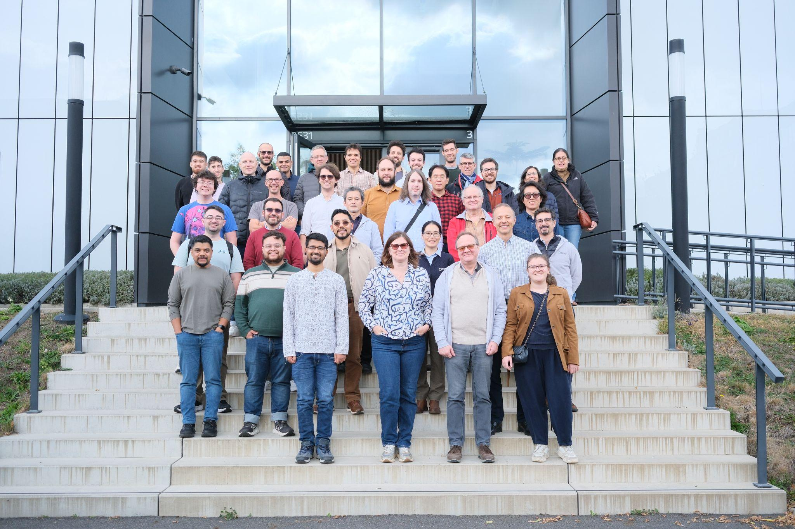
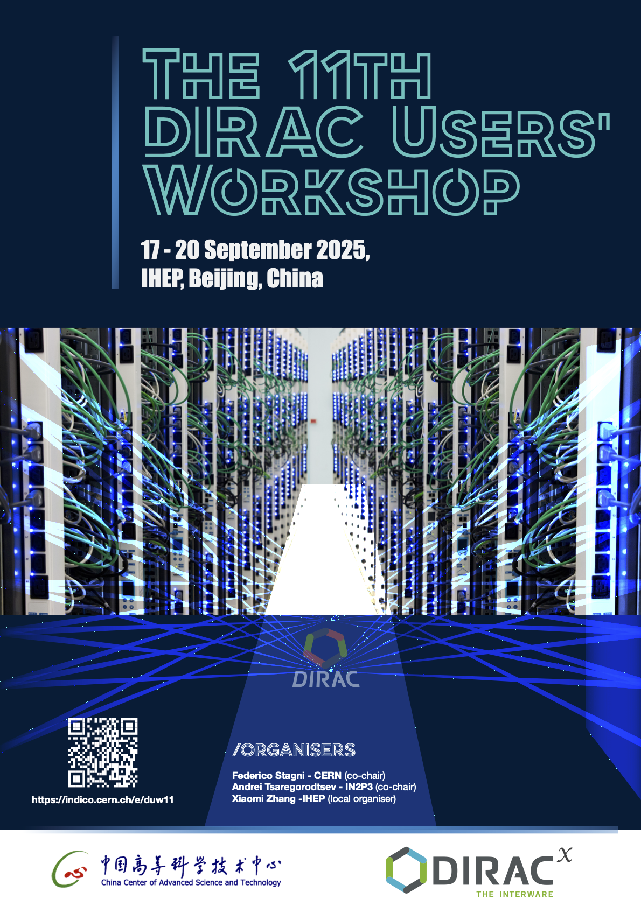

## 12th DIRAC(X) Users’ Workshop

The 12th DIRAC(X) Users’ Workshop brought together about 50 participants from 16 countries in Prague, Czech Republic, on 13–16 October 2026. Hosted by the Institute of Physics of the Czech Academy of Sciences (FZU) in cooperation with CESNET, the four-day workshop gave developers, service administrators, and researchers a chance to share their experience and discuss the future of the DIRAC distributed computing framework.

**DiracX Development and Migration**

The workshop focused on the transition from DIRAC to DiracX, the next generation of the framework. Participants discussed how to modernize workload and data management, what an analytics platform should provide, and how DiracX can fit into existing computing environments. **The Transformation System** was a particular focus: hands-on sessions gave participants a chance to work through its design and explore how to describe scientific workflows with the **Common Workflow Language (CWL)**.

Participants also discussed how to deploy DiracX and keep production services running reliably during the transition. Supporting smaller scientific communities was an important part of that discussion. The next steps are to complete essential DiracX features, make deployment easier across different computing environments, and help existing DIRAC installations migrate gradually.

**Community Experience and New Developments**

Representatives from LHCb, Belle II, CMS, CTAO, ILC/FCC, and other communities shared how they run their computing services today and what they will need from DiracX. LHCb and CTAO brought example workflows to the CWL sessions, and Belle II, CMS, and JUNO began contributing examples of their own. These examples gave developers and users a concrete way to compare requirements across experiments and identify priorities for future work.

**Further Information**

- [Workshop agenda and presentations](https://indico.cern.ch/event/1588323/timetable/?view=standard_numbered)
- [Workshop conclusions — Federico Stagni (PDF)](https://indico.cern.ch/event/1588323/contributions/7264830/attachments/3363536/6034810/The%2012th%20DIRAC(X)%20Users%E2%80%99%20Workshop.pdf)
- [Workshop report by FZU](https://www.fzu.cz/en/research/divisions-and-departments/division-1/department-33/news/experts-distributed-computing-gather-prague-dirac-workshop-focuses-future-scientific-data-processing)
- [Workshop photographs and additional materials](https://indico.cern.ch/event/1588323/)

## 11th DIRAC User's Workshop

The next DIRAC User's Workshop will take place in IHEP, Beijing, on the 17th-20th September. The workshop will be devoted to the information exchange between the Dirac(X) developers, service administrators and users. Reports on the Dirac(x) ongoing and planned developments, service management tools will be included into the agenda together with the users reporting their experience. You are welcome to suggest your items to the [workshop agenda](https://indico.cern.ch/event/1433941/). You can also register there if you are planning to participate in person.

